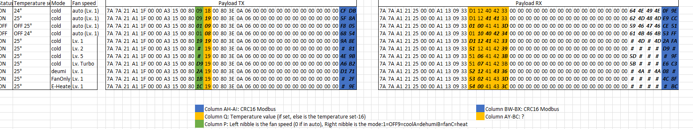
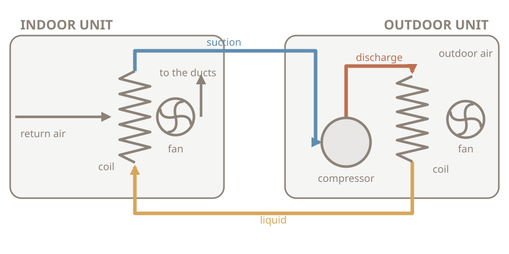
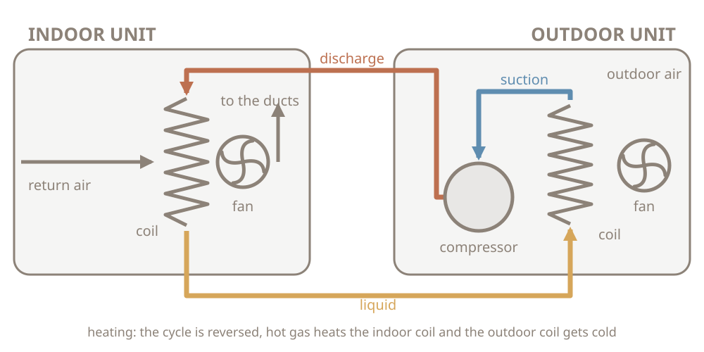
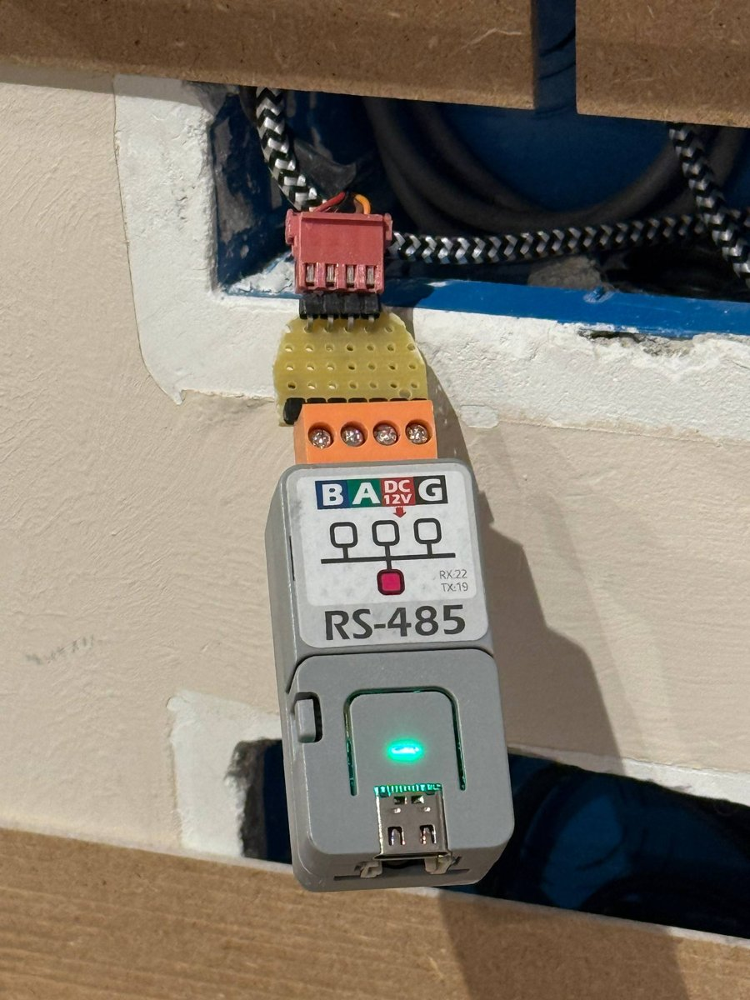
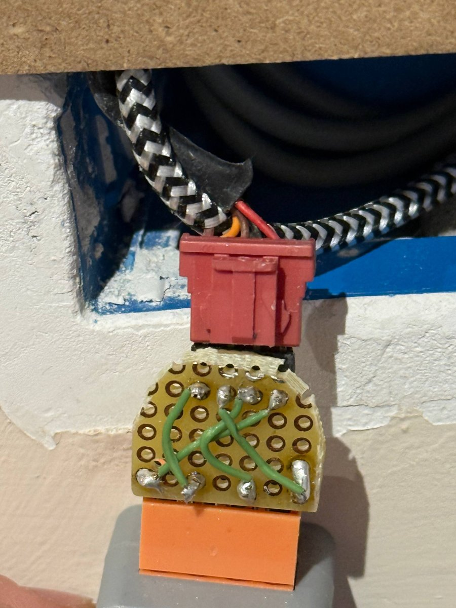

# smartAircon: RS485 controller for a ducted air conditioner

> **Built for one specific unit**: an R32 ducted split with indoor unit **SDVH12M-A3NA** (the same service manual
> covers SDVH18M / SDVH24M-A3NA, outdoor SAVH…A-A3NA), wired controller **XKRB1**, indoor board
> **K32600059 SCN904-Z**. I am publishing it in case it works, or helps, on other models with the same board or
> wall controller, but **nothing here has been tested on anything else**. Captures from other units are welcome.

An **M5Stack Atom Lite** with an RS485 transceiver that talks to the indoor unit of a ducted air conditioner in
place of the wired wall controller, and exposes it to **Home Assistant** over MQTT.

## Who did what

**Version 1 is mine.** I sniffed the bus, built the table below (in a spreadsheet) and wrote the firmware that
replaces the wall controller. It worked and I was happy with it. **Years later I asked
[Claude](https://claude.com/claude-code)** (Anthropic's AI, working in Claude Code on my Home Assistant machine)
whether I had missed anything, and Claude did the rest: reading and decoding the replies, the CRC, the bus timing
fix, the capture to files, the Home Assistant discovery and dashboards, every firmware version from 2.0 on (flashed
over the air), and this README. My part from then on was running the tests it asked for.

## The story

### 1. Clone the controller (me)

The only way to drive this unit was its wired wall controller, on a 4-wire RS485 bus (A, B, GND, +12 V) to the indoor
board. I wanted it in Home Assistant, so I put a sniffer on that bus and changed one setting at a time on the
controller: mode, fan, temperature. The controller repeats one 31-byte frame, and only two bytes change:

```
7A 7A 21 A1 1F 00 00 A3 15 00 80 [01] [08] 00 80 3E 0A 06 00 … 00 68 54     ← off      (set point 24 → 24 − 16 = 0x08)
7A 7A 21 A1 1F 00 00 A3 15 00 80 [0C] [1A] 00 80 3E 0A 06 00 … 00 62 6A     ← heat, 26 °C, fan auto
7A 7A 21 A1 1F 00 00 A3 15 00 80 [5C] [1A] 00 80 3E 0A 06 00 … 00 73 7B     ← heat, 26 °C, fan 5
```



Byte 11 is fan (high nibble) + on bit + mode (low nibble), byte 12 the set point. Version 1 of this firmware
**replaced the wall controller** and simply sent clones of that frame with those two bytes changed (with both
controllers on the bus, nothing worked). It ran like that for years, and it only ever *talked*.

### 2. Listen to the answers (Claude)

The indoor unit answers with 37 bytes. Version 2 started reading them. The last two bytes are a **CRC16/Modbus**,
high byte first (checked on captured frames), so bad frames can be thrown away:

```
7A 7A A1 21 25 00 00 A1 13 09 33 [03] 00 40 3F 3E 00 … 00 31 31 32 31 8E 22      ← off, everything at ~9 °C
```

Temperatures are `value − 40`: `3F` = 23 °C room (return air), `3E` = 22 °C indoor coil.

First surprise: v1 sent a new command after every 5 ms of bus silence, about **26 commands a second**, and the unit
replied only **2–3 times a minute**. With one command per second it replies **~930 times a minute**, with zero CRC
errors. The send interval is now adjustable from Home Assistant.

### 3. A heating run, byte by byte (Claude)

With the whole bus captured to a file, switching to heat at 26 °C and playing with the fan gave (byte 11, 12, 17, 18
and the outdoor bytes 31–34, read from the replies):

```
12:03:56  HA: mode = heat
12:03:57  11=13  12=00  17=00  18=00   31..34 = 31 31 32 31    ← start requested (bit 4)
12:04:12  11=54  12=00                                          ← on (bit 6)
12:04:54  11=D4  12=00                                          ← compressor running (bit 7)
12:04:55  11=D4  12=00  17=04                                   ← hot start: fan held off
12:06:54  11=D4  12=02  17=04          31..34 = 3F 31 31 31    ← fan at minimum, discharge warming up
12:07:54  11=D4  12=06  17=00          31..34 = 43 30 31 30    ← hot start over, fan 5 → real speed 6
12:08:49  11=D4  12=06  17=00  18=10   31..34 = 4C 30 31 30    ← discharge 36 °C, outdoor coil cooling down
```

That pinned down the **start-requested / on / compressor** bits, the **real fan speed** (commanded 1/3/5 shows as
2/4/6), the 3-minute **hot start** that ignores the requested fan speed, and the outdoor temperatures: compressor
discharge went from 9 to 80 °C during the run, the outdoor coil from 9 to 1 °C. An earlier guess, an "outdoor unit
active" bit, never showed up in 10 minutes of compressor running and was removed.

Still open: byte 18 (`10` after ~4 minutes of compressor in heat mode; defrost has not been captured yet, and the
service manual describes a forced defrost that should help), and bytes 13–17 of the command (`00 80 3E 0A 06`;
`0x3E` − 40 = 22 °C looks like a "follow me" temperature from the controller).

## Not sure how to install it?

If the steps below are not enough, give [docs/INSTALL-WITH-CLAUDE.md](docs/INSTALL-WITH-CLAUDE.md) to your own
Claude (or another AI assistant), together with a link to this repository. It is written for the assistant: it asks
you the right questions, checks your unit and your wiring before anything is powered, and walks you through flashing,
Home Assistant and the first test one step at a time.

## What you get

- **Control**: mode (off, cool, dry, fan only, heat), set point, fan speed, as a regular Home Assistant `climate`
  entity.
- **Read back** what the unit is actually doing: on / start requested, compressor, real fan speed, hot-start phase,
  room (return-air) temperature, indoor coil, outdoor coil, compressor discharge, outdoor air.
- **Debug**: raw replies, a log of every byte that changes, CRC statistics, adjustable send interval, test override
  of the unknown command bytes, capture of the whole bus to files in Home Assistant.

The protocol is documented in [docs/PROTOCOL.md](docs/PROTOCOL.md).

> Entity names and code comments are in Italian (my language). The README and the protocol are in English.




The two diagrams are the ones on my Home Assistant dashboard (live temperatures are drawn on top of them).

## Hardware

- M5Stack Atom Lite + RS485 transceiver (e.g. the M5Stack ATOM RS485 base): **RX G22, TX G19**.
- The Atom **replaces** the wired wall controller: disconnect the original one. With both on the bus nothing worked
  (two controllers sending commands to the same indoor unit).
- Tested only on the unit described at the top (indoor board K32600059 SCN904-Z, wall controller XKRB1).

### Wiring

The wall controller is connected to the indoor board with a 4-core cable to the connector marked **485-1 / 485-2**
(item 3, "wire controller communication interface", in the PCB diagram of the service manual). Its pins are:

| Indoor board | RS485 transceiver |
|---|---|
| A | A |
| B | B |
| GND | GND |
| +12 V | power input, **only** if your RS485 board accepts 12 V; otherwise power the Atom via USB |

If nothing comes back, swap A and B (there is no damage risk).

**Tested setup**: M5Stack Atom Lite on the **M5Stack ATOM RS485 base** (terminals B, A, DC 12V, G; RX G22, TX G19),
powered from the **+12 V of the wall-controller cable**, no USB needed. The original controller's plug (the red
4-pin one) goes into a pin header on a small perfboard, whose wires remap the pins to the base's terminal block. Check
your own pin order with a multimeter (12 V between +12 V and GND) before connecting.

 

## Firmware

Arduino, ESP32 core **2.0.17** (M5Atom does not build on 3.x), libraries **M5Atom**, **FastLED 3.6.0** (3.10 breaks
M5Atom), **PubSubClient**.

```sh
cp smartAircon/secrets.example.h smartAircon/secrets.h     # Wi-Fi, MQTT user/password, broker address
arduino-cli compile --fqbn esp32:esp32:m5stack-atom smartAircon --output-dir build
arduino-cli upload  --fqbn esp32:esp32:m5stack-atom -p /dev/ttyACM0 smartAircon     # first time, via USB
```

OTA afterwards: hostname `smartaircon-ingresso`, port 3232, no password (keep it on a trusted network).

After a reboot the set point restarts from 24 °C until Home Assistant sends a command.

## Home Assistant

1. An MQTT broker (the **Mosquitto** add-on) and the **MQTT** integration; put a Home Assistant user in `secrets.h`.
2. Add the climate entity from [homeassistant/climate.yaml](homeassistant/climate.yaml) to `configuration.yaml` and
   restart.
3. The sensors appear by themselves (MQTT discovery) under the device **"Climatizzatore (controller RS485)"**.
4. Optional: [homeassistant/pyscript/trama_climatizzatore.py](homeassistant/pyscript/trama_climatizzatore.py) (needs
   [pyscript](https://github.com/custom-components/pyscript)) saves every capture started with the *Registra trama*
   switch to `/config/smartaircon/catture/YYYYMMDD-HHMMSS.txt`. The capture stops by itself after 60 minutes.

### MQTT topics

| Topic | |
|---|---|
| `aircon/mode/cmd`, `aircon/setpoint/cmd`, `aircon/velocity/cmd` | commands (+ `/state`, `/tele`) |
| `aircon/currentTemp/state` | room temperature, used by the climate entity |
| `aircon/reply/json` | decoded reply + `raw` |
| `aircon/reply/raw`, `aircon/tx/raw` | last reply / last command, hex |
| `aircon/log` | one line per changed reply byte, plus events |
| `aircon/stats` | good replies, CRC errors, other frames, RSSI, uptime, free memory |
| `aircon/debug/override` | test a command byte: `15=48` (position=hex value, positions 13–28), `clear`; expires after 15 min |
| `aircon/debug/interval` | ms between commands (default 1000) |
| `aircon/debug/capture`, `aircon/capture` | capture ON/OFF, captured data |
| `aircon/status` | online / offline (last will) |

## License

MIT, see [LICENSE](LICENSE). Not affiliated with the air-conditioner manufacturer; trademarks belong to their owners.
