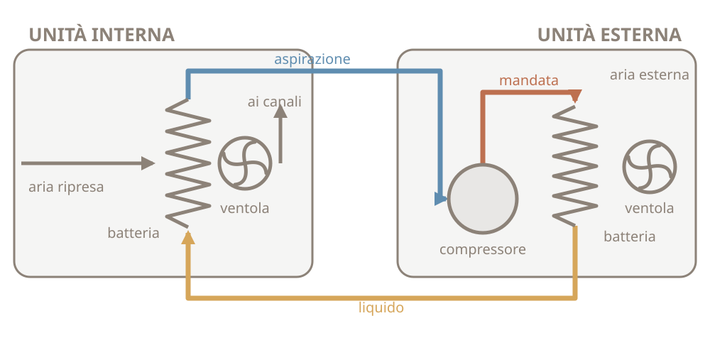

# smartAircon: RS485 controller for a ducted air conditioner

An **M5Stack Atom Lite** with an RS485 transceiver that talks to the indoor unit of a ducted air conditioner in
place of the wired wall controller, and exposes it to **Home Assistant** over MQTT.

- **Control**: mode (off, cool, dry, fan only, heat), set point, fan speed, as a regular Home Assistant `climate`
  entity.
- **Read back** what the unit is actually doing: on / start requested, compressor, real fan speed, hot-start phase,
  room (return-air) temperature, indoor coil, outdoor coil, compressor discharge, outdoor air.
- **Debug**: raw replies, a log of every byte that changes, CRC statistics, adjustable send interval, test override
  of the unknown command bytes, capture of the whole bus to files in Home Assistant.

The protocol is documented in [docs/PROTOCOL.md](docs/PROTOCOL.md).

> Entity names and code comments are in Italian (the author's language). The README and the protocol are in English.



## Hardware

- M5Stack Atom Lite + RS485 transceiver (e.g. the M5Stack ATOM RS485 base): **RX G22, TX G19**.
- The Atom **replaces** the wired wall controller: disconnect the original one. With both on the bus nothing worked
  (two controllers sending commands to the same indoor unit).
- Indoor unit: **TODO model**.
- Wiring to the indoor unit: **TODO** (connector, A/B, power).

## Firmware

Arduino, ESP32 core **2.0.17** (M5Atom does not build on 3.x), libraries **M5Atom**, **FastLED 3.6.0** (3.10 breaks
M5Atom), **PubSubClient**.

```sh
cp smartAircon/secrets.example.h smartAircon/secrets.h     # Wi-Fi, MQTT user/password, broker address
arduino-cli compile --fqbn esp32:esp32:m5stack-atom smartAircon --output-dir build
arduino-cli upload  --fqbn esp32:esp32:m5stack-atom -p /dev/ttyACM0 smartAircon     # first time, via USB
```

OTA afterwards: hostname `smartaircon-ingresso`, port 3232, no password (keep it on a trusted network).

After a reboot the set point restarts from 24 °C until Home Assistant sends a command.

## Home Assistant

1. An MQTT broker (the **Mosquitto** add-on) and the **MQTT** integration; put a Home Assistant user in `secrets.h`.
2. Add the climate entity from [homeassistant/climate.yaml](homeassistant/climate.yaml) to `configuration.yaml` and
   restart.
3. The sensors appear by themselves (MQTT discovery) under the device **"Climatizzatore (controller RS485)"**.
4. Optional: [homeassistant/pyscript/trama_climatizzatore.py](homeassistant/pyscript/trama_climatizzatore.py) (needs
   [pyscript](https://github.com/custom-components/pyscript)) saves every capture started with the *Registra trama*
   switch to `/config/smartaircon/catture/YYYYMMDD-HHMMSS.txt`. The capture stops by itself after 60 minutes.

### MQTT topics

| Topic | |
|---|---|
| `aircon/mode/cmd`, `aircon/setpoint/cmd`, `aircon/velocity/cmd` | commands (+ `/state`, `/tele`) |
| `aircon/currentTemp/state` | room temperature, used by the climate entity |
| `aircon/reply/json` | decoded reply + `raw` |
| `aircon/reply/raw`, `aircon/tx/raw` | last reply / last command, hex |
| `aircon/log` | one line per changed reply byte, plus events |
| `aircon/stats` | good replies, CRC errors, other frames, RSSI, uptime, free memory |
| `aircon/debug/override` | test a command byte: `15=48` (position=hex value, positions 13–28), `clear`; expires after 15 min |
| `aircon/debug/interval` | ms between commands (default 1000) |
| `aircon/debug/capture`, `aircon/capture` | capture ON/OFF, captured data |
| `aircon/status` | online / offline (last will) |

## License

MIT, see [LICENSE](LICENSE). Not affiliated with the air-conditioner manufacturer; trademarks belong to their owners.
