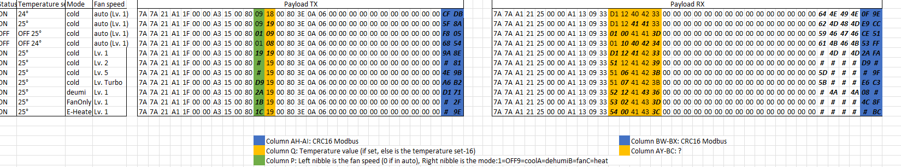

# Protocol: wired controller ↔ indoor unit (RS485)

RS485, **9600 8N1**. The controller sends a 31-byte command; the indoor unit answers with a 37-byte frame
(about every 62 ms, followed by `00 00 00`). CRC is **CRC16/Modbus** over the frame without the last two bytes,
**high byte first**.



## Command (controller → indoor unit, 31 bytes)

```
7A 7A 21 A1 1F 00 00 A3 15 00 80 [CMD] [TEMP] 00 80 3E 0A 06 00 … 00 [CRC hi] [CRC lo]
```

| Byte | Meaning |
|---|---|
| 11 `CMD` | high nibble = fan (0 auto, 1–5, `D` turbo); low nibble: bit 3 = on, bits 0–2 = mode (1 cool, 2 dry, 3 fan only, 4 heat). So `1` = off, `9` cool, `A` dry, `B` fan, `C` heat |
| 12 `TEMP` | set point in °C (when off: set point − 16) |
| 13–17 | `00 80 3E 0A 06`, unknown. Guess: `0x3E` − 40 = 22 °C = temperature measured by the controller ("follow me") |

The firmware can override bytes 13–28 for testing (`aircon/debug/override`, e.g. `15=48`; expires after 15 minutes).

Send rate matters: sending a command after every 5 ms of bus silence (26 commands/s) made the indoor unit answer only
2–3 times a minute; with one command per second it answers ~930 times a minute with zero CRC errors.

## Reply (indoor unit → controller, 37 bytes)

```
7A 7A A1 21 25 00 00 A1 13 09 33 [11] [12] [13] [14] [15] 00 … [31] [32] [33] [34] [CRC hi] [CRC lo]
```

Temperatures are `value − 40` °C.

| Byte | Meaning |
|---|---|
| 11 | bits 0–2 mode · bit 4 start requested (rises on the command, falls first) · bit 6 on · bit 7 compressor running. Heat start-up: `03 → 13 → 14 → 54 → D4`; shut-down: `D4 → C4 → 04` |
| 12 | actual indoor fan speed (0 stopped, 2 low … 6 high, 7 turbo; commanded 1/3/5 → 2/4/6) |
| 13 | set point |
| 14 | room temperature (return air) |
| 15 | indoor coil |
| 17 | `04` = hot start (anti cold-air): for 3 minutes after the compressor starts the fan stays off (2 min), then at minimum, ignoring the requested speed |
| 18 | `10` after ~4 minutes of compressor in heat mode, `00` at shut-down: unknown (defrost not seen yet) |
| 31 | compressor discharge |
| 32, 34 | outdoor coil (always equal) |
| 33 | outdoor air |

Confirmed in heat mode: discharge 9 → 80 °C, outdoor coil 9 → 1 °C, outdoor air 8–10 °C. After switching off in heat
mode the fan keeps running at minimum for one minute.
